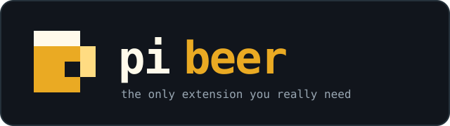
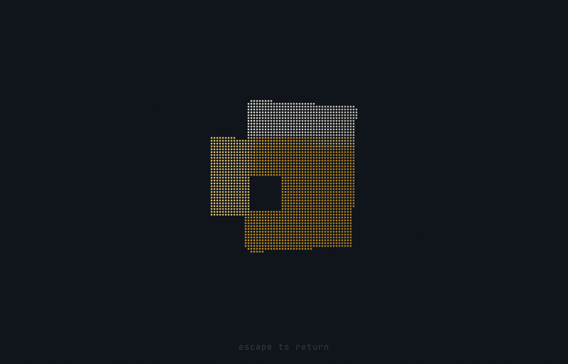

# pi-beer



We gave Pi a beer. Click the mug and watch it go for a spin.



## Install

```sh
pi install git:github.com/Alurith/pi-beer
```

Run `/reload` in an existing Pi session, or restart Pi.

## Use

Click the beer logo or run `/beer` to start the animation. Press Escape to return. A second press skips the return animation.

Run `/beer-config` to change the beer:

| Setting | Options |
| --- | --- |
| Beer | Pale, Amber, Dark, Weiss |
| Vessel | Classic mug, Handleless glass, Tall slim glass |
| Foam | Yes, No |

**Reset to defaults** restores the original pale beer, classic mug, and foam.

The animation requires Pi's fullscreen terminal mode. The extension has been tested with Pi 1.5.2.

## Preferences

Preferences are stored in `beer-mug.json` inside Pi's agent directory. The default location is `~/.pi/agent/beer-mug.json`. Setting `PI_CODING_AGENT_DIR` changes that directory.

Preferences are shared across projects. Use `/beer-config` to edit them.

## Update or remove

```sh
pi update --extensions
pi remove git:github.com/Alurith/pi-beer
```

Removal does not delete the saved preferences.

## Development

The tests use an installed Pi package as their reference. Set `PI_PACKAGE_ROOT` to the directory containing Pi's `package.json`:

```sh
PI_PACKAGE_ROOT=/path/to/pi-coding-agent npm test
```

The suite checks every style combination, preference persistence, menu behavior, and native-animation frame parity. The native reference is Pi 1.5.2.

Inspect the distribution files without publishing:

```sh
npm pack --dry-run
```

This project currently uses Git distribution. `private: true` prevents accidental npm publication.

## License

MIT. The animation and startup layout adapt Pi's implementation. See [LICENSE](LICENSE) and [UPSTREAM.md](UPSTREAM.md) for the upstream notice and source details.
